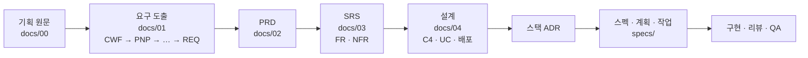

# architect-template

기획 원문에서 요구사항 · PRD · SRS · 아키텍처 설계(C4)까지를 **AI 에이전트와 함께, 근거가 끊기지 않게** 만들어 가기 위한 저장소 템플릿이다. Claude Code 용 규칙(하네스)과 문서 양식, 문서 검사 스크립트만 들어 있다.

**언어 · 프레임워크 · 인프라는 들어 있지 않다.** 어떤 스택으로 만들든 그 앞 단계 — 무엇을 왜 만드는지 정하고 구조로 옮기는 일 — 는 같기 때문이다. 스택은 SRS 가 승인된 뒤 ADR 로 고른다.

## 무엇이 들어 있나

| 자리 | 내용 |
| --- | --- |
| `CLAUDE.md` · `.claude/rules/` | 에이전트의 상시 지침과 구속 규칙 — 역할 경계(문서는 사람, 구현은 에이전트) · SOLID · 클린 아키텍처 · 12-Factor · 보안(OWASP Top 10) · 시험 · 결정 기록 · 작업 흐름 |
| `.claude/rules/requirements-engineering/` | 원자료 → 사실 → 문제 → 분석 → 요구 → PRD → FR/NFR 로 내려가는 요구 도출 파이프라인과 출력 양식 |
| `.claude/rules/architecture-diagram/` | C4 Context · Container · Component, 유스케이스, Activity, 배포, DFD, 시퀀스 다이어그램 작성 규칙 |
| `docs/00` ~ `docs/04` | 위 규칙이 채우는 문서 골격. 예시 도메인(공유 회의실 예약)으로 형식을 보여 준다 |
| `specs/` · `.specify/` · `.claude/skills/` | 기능 단위 스펙 → 계획 → 작업 분해(Spec Kit) 양식과 번호 레지스트리, 헌법 |
| `scripts/` | 문서 검사 — bash 와 기본 유틸만 쓴다 |

## 흐름



1. **위에서 아래로만 흐른다.** 모든 항목은 바로 위 계층의 ID 를 근거로 가진다. 아래에서 새 사실이 나오면 위 문서부터 고치고 다시 내려온다.
2. **근거 없는 것은 만들지 않는다.** 판단이 갈리면 결정하지 않고 질문(`Q-NNN`)으로 남긴다. 사람이 위임하면 권장안을 골라 결정(`D-NNN`)으로 기록하고 계속한다.
3. **단계마다 사람 검토가 게이트다.** 요구 · 아키텍처 문서는 사람의 것이고, 에이전트는 초안을 쓰고 승인된 문서를 어기지 않는 코드를 쓴다.
4. **세지 않고 검사한다.** ID 연속성 · 커버리지 · 집합 · 링크는 스크립트가 센다.

## 시작하기

1. **가져온다.** GitHub 에서 「Use this template」을 누르거나, 내려받아 새 폴더에 두고 `git init` 한다.
2. **빈칸을 채운다.** `CLAUDE.md` 「이 프로젝트」 절과 헌법 `.specify/memory/constitution.md` 의 `<…>`. 남은 빈칸과 예시는 `scripts/check-leaks.sh` 가 알려 준다.
3. **기획 원문을 넣는다.** 받은 자료나 직접 쓴 기획서를 `docs/00.project-proposal/` 에 넣고 Claude Code 에게 요청한다.
   > `docs/00.project-proposal` 의 자료로 요구사항을 도출해 줘. `requirements-engineering/source-intake` 부터 따라.
4. **결정 대기 목록을 본다.** 에이전트가 `docs/01.requirements/todo.md` 에 모은 질문에 답한다. 이 목록이 줄어드는 속도가 요구가 확정되는 속도다.
5. **PRD → SRS → 설계**로 내려간다. 단계마다 검사를 돌린다.
   ```bash
   scripts/check-requirements.sh
   scripts/check-diagrams.sh
   ```
6. **스택을 고른다.** `docs/04.design/01.architecture/02.adr/` 에 ADR 을 쓰고 아래 「스택을 고른 뒤」를 따른다.
7. **기능 단위로 만든다.** `speckit-specify` → `speckit-plan` → `speckit-tasks` → `speckit-implement`. 번호는 `specs/DECISIONS.md` 에서 먼저 잡는다.

## 스택을 고른 뒤

템플릿이 비워 둔 자리다. 한 번에 채운다.

| 자리 | 채울 것 |
| --- | --- |
| ADR | 고른 스택과 버린 대안, 근거 NFR |
| 헌법 「추가 제약」 기술 스택 표 | 언어 · 저장소 · 클라이언트 · 실행 방식 |
| `CLAUDE.md` 「저장소 지도」 · 「명령」 | 코드 폴더 배치 · 빌드 · 시험 · 실행 명령 |
| `docs/04.design` 02 · 07 | 컨테이너의 기술 칸 · 배포 노드의 벤더 대응표 |
| `.claude/rules/` | 그 스택의 관례(인터페이스 규약 · 스키마 이행 · 배포)를 `paths:` 조건부 규칙으로 더한다 |
| `.claude/settings.json` deny · `.gitignore` | 그 스택의 파괴적 명령 · 빌드 산출물 |
| 아키텍처 검사 | `AR-nn` 규칙을 그 스택의 의존 검사 도구로 만든다(`component-package-mapping` §6) |

## 다이어그램

**Mermaid 가 1차 도구다.** 문서 안의 Mermaid 블록이 정본이라 변경이 diff 로 보이고, GitHub 와 대부분의 편집기가 설치 없이 그린다. 발표 · 검토용으로 한 장에 다듬은 그림이 필요하면 archify 같은 렌더 플러그인을 추가로 쓸 수 있다 — 그때도 정본은 Mermaid 이고 내용이 같아야 한다.

문법까지 기계로 확인하려면(선택) 로컬의 `mermaid.min.js` 와 Chrome 계열 브라우저 경로를 준다.

```bash
MERMAID_JS=/path/to/mermaid.min.js scripts/check-diagrams.sh --mermaid
```

## 검사 스크립트

| 스크립트 | 보는 것 |
| --- | --- |
| `check-requirements.sh` | 요구 문서의 ID 연속성 · 결번 · 미정의 참조 · FR 10필드 · AC 개수 · 금지 문체 · 건수 · 링크 |
| `check-diagrams.sh` | 설계 문서의 FR 커버리지 · CON · CMP · UC · 액터 집합 · 링크 · Mermaid 블록. `CODE_ROOTS` 를 주면 코드 모듈 ↔ 컴포넌트 매핑표 |
| `check-spec-coverage.sh` | 스펙의 결번 · 결정 칸 · 결정 번호 충돌 · 레지스트리 범위 |
| `check-leaks.sh` | 남은 예시 도메인 · 빈칸 `<…>` · (패턴 파일을 주면) 다른 프로젝트에서 따라온 값 |

## 운영 모드

기본은 **모드 B(1인 로컬)** 다 — 에이전트는 요청받을 때만 커밋하고, `git push` 와 `gh` 는 `.claude/settings.json` 의 deny 가 막는다. 팀으로 쓰려면(모드 A) deny 에서 `Bash(git push*)` · `Bash(gh *)` 두 줄을 지우고 `CLAUDE.md` 「운영 모드」를 고친다(`.claude/rules/git-workflow.md`).

## 전제와 한계

- 문서와 규칙은 한국어로 쓰여 있다.
- Claude Code 를 기준으로 만들었다. 다른 에이전트는 `AGENTS.md` 가 `CLAUDE.md` 를 가리킨다.
- 예시 도메인은 가상의 「공유 회의실 예약」이다. 실제 서비스 · 회사 · 사람의 정보는 들어 있지 않다.
- 규칙은 안전띠이지 보증이 아니다. deny 는 글자를 맞춰 볼 뿐이고, 검사 스크립트는 정해진 표기만 읽는다.

## 출처와 라이선스

- `.specify/` 와 `.claude/skills/speckit-*` 는 [GitHub Spec Kit](https://github.com/github/spec-kit)(MIT)에서 온 파일이고, 양식 일부(`.specify/templates/`)를 이 템플릿에 맞게 고쳤다. Spec Kit 을 올릴 때는 고친 양식이 덮어쓰이지 않는지 diff 로 확인한다.
- 그 밖의 내용은 [MIT 라이선스](LICENSE)다.
