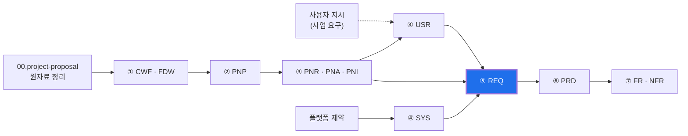

# 01.requirements — 요구사항 계층

> **작성일**: YYYY-MM-DD · **최종 개정**: YYYY-MM-DD
> **파이프라인 규칙**: `.claude/rules/requirements-engineering/requirements-pipeline`
> **원자료**: [../00.project-proposal/](../00.project-proposal/README.md)
> **정본 위치**: 이 README §1이 **건수 · ID 범위의 유일한 정본**이다. 다른 문서는 건수를 적지 않고 여기를 링크한다. <!-- 베이스라인 이후 구현에서 바뀐 동작을 아직 따라잡지 못했으면 여기에 선언한다: 「YYYY-MM-DD 이후 동작의 정본은 specs/<NNN>/spec.md 결정 기록이다. 요구 문서는 개정 이력이 따라잡은 곳까지만 정본이다」 -->

요구사항 계층은 **사실 → 문제 → 분석 → 요구 → 정립**의 단방향 파이프라인이다. 각 문서는 바로 위 문서의 ID를 근거로 가지며, 하위 문서를 상위 근거로 쓰지 않는다. `REQ`가 경계점이다 — 그 위는 REQ의 근거, 그 아래(`02.prd` · `03.srs`)는 REQ의 결과물이다.

## 1. 문서 지도

「건수」 열은 활성 항목 수(결번 제외)다. `scripts/check-requirements.sh`가 이 열을 실제 정의 수와 비교한다 — 코드 하나에 한 행, 칸에는 숫자만 쓴다.

| 단계 | 계층 | 코드 | 파일 | 건수 | ID 범위 · 결번 · 비고 | 상태 |
| :---: | --- | --- | --- | ---: | --- | :---: |
| 0 | 원자료 | — | [../00.project-proposal/](../00.project-proposal/README.md) | — | `P-n` · `S-n` · `Q-<주제>n` · `X-n` | 미작성 |
| — | 용어 | — | [glossary.md](glossary.md) | — | 도메인 용어 · 역할 | 미작성 |
| 1 | 사실 | `CWF` | [current-workflow.md](current-workflow.md) | 0 | — | 미작성 |
| 1 | 사실 | `FDW` | [concurrent-workload.md](concurrent-workload.md) | 0 | — | 미작성 |
| 2 | 문제 | `PNP` | [pain-points.md](pain-points.md) | 0 | 항목 0 | 미작성 |
| 3 | 분석 | `PNR` | [pain-points-root-causes.md](pain-points-root-causes.md) | 0 | — | 미작성 |
| 3 | 분석 | `PNA` | [pain-points-amplifiers.md](pain-points-amplifiers.md) | 0 | — | 미작성 |
| 3 | 분석 | `PNI` | [pain-points-impacts.md](pain-points-impacts.md) | 0 | — | 미작성 |
| 4 | 요구 | `USR` | [user-stories.md](user-stories.md) | 0 | AC 0 | 미작성 |
| 4 | 요구 | `SYS` | [system-requirements.md](system-requirements.md) | 0 | 고유 제약 0 | 미작성 |
| 5 | **정립** | `REQ` | [user-requirements.md](user-requirements.md) | 0 | — | 미작성 |
| 6 | 파생 | `PRD` | [../02.prd/](../02.prd/README.md) | 0 | 영역 0 | 미작성 |
| 7 | 파생 | `FR` | [../03.srs/srs_03_functional_requirements.md](../03.srs/srs_03_functional_requirements.md) | 0 | — | 미작성 |
| 7 | 파생 | `NFR` | [../03.srs/srs_04_non_functional_requirements.md](../03.srs/srs_04_non_functional_requirements.md) | 0 | — | 미작성 |
| 8 | 검증 | — | [todo.md](todo.md) · [CHANGELOG.md](CHANGELOG.md) | — | 결정 대기 `Q-NNN` | 미작성 |

**상태 어휘**: `미작성` · `진행` · `✅` · `✅ 승인 대기`(AI가 도출해 사람의 승인을 기다림 — 역도출 스토리 · PRD 초안).

> 그림에는 건수를 적지 않는다 — 건수는 위 표 한 곳이다.

## 2. 읽는 순서

### 2.1 처음 읽는 사람

1. [glossary.md](glossary.md) — 표준 용어와 동의어
2. [current-workflow.md](current-workflow.md) — 지금 일하는 순서
3. [user-requirements.md](user-requirements.md) — 결론
4. [todo.md](todo.md) — 아직 정하지 않은 것

### 2.2 근거를 따라가는 사람

`REQ-nnn` → 근거 열의 굵은 `USR-nnn AC-k` / `SYS-nnn` → 그 문서의 `Business Impact` / `영향` 열의 `PNR`/`PNI` → 그 행의 `출처` 열 `PNP-00n` → `CWF-00n` → 원자료 절

### 2.3 한 가지 요구의 뿌리를 보고 싶은 사람

예: "<왜 이 요구가 필요한가>"

<!-- 예시(회의실 예약 — 실제 사슬을 쓰면 지운다):
"왜 예약이 겹치면 저장을 막는가"
`REQ-003` ← `USR-201 AC-2` ← `PNI-101`(회의 취소 손실) ← `PNR-101`(빈 시간을 눈으로 찾음) ← `PNP-002` ← `CWF-002` Step 2-1 ← 조사 P-1 · screen-02
-->

### 2.4 커버리지

| 관계 | 검사 방법 | 결과 |
| --- | --- | :---: |
| `PNP` → `PNR`·`PNA`·`PNI` | PNP 항목마다 분석 행 1개 이상 | — |
| `PNR`·`PNA`·`PNI` → `REQ` | 각 문서 「대응 REQ」 표 | — |
| `USR` → `REQ` | 각 Story 「파생 요구사항」 | — |
| `SYS` → `REQ` | REQ 부록 A (스크립트) | — |
| `REQ` ← 근거 | 굵은 직접 출처 | — |
| `REQ` → `PRD` 배분 | REQ 부록 E · PRD §13.1 `검증식:` (스크립트) | — |
| `REQ` → `FR`·`NFR` | `Related Requirements` 역색인 (스크립트) | — |

결과 칸에는 `✅` · `⚠ <미대응 ID>`만 쓴다. 건수는 §1에 있다.

## 3. 번호 체계

**모든 ID는 `AAA-###`** — 대문자 코드 + 하이픈 + 3자리 숫자.

| 방식 | 문서 | 규칙 |
| --- | --- | --- |
| 순차 | `CWF` `FDW` `PNP` | 끝자리 = Step/섹션 번호 (`CWF-00n` = Step n) |
| 카테고리 | `PNR` `PNA` `PNI` `USR` `SYS` `PRD` | 백의 자리 = 카테고리/Epic/영역, 나머지 = 일련번호 |
| 순차 | `REQ` `FR` `NFR` | 전체 연속. 카테고리는 섹션으로만. 결번 유지 |
| 질문 | `Q-NNN` | `todo.md` §1 결정 대기. 저장소 전체 한 계열(스펙 미결과 공유) — `.claude/rules/decisions`. 결정되면 질문에 취소선 · 상태 칸에 `<결정 상태> YYYY-MM-DD (D-NNN)` |
| 결정 | `D-NNN` | 저장소 전체 한 계열 — `.claude/rules/decisions` |
| 조사 | `P-n` `S-n` `Q-<주제>n` `X-n` | 원자료 정리 문서 안 번호(`source-intake` §5) |

**결번**: 지운 항목은 ID에 취소선(`~~REQ-0nn~~`)을 긋고 행을 남긴다. 번호는 재사용하지 않고, 되살리면 새 번호를 받는다.

**끝 번호 이어 붙이기**: 새 항목은 기존 항목 사이에 끼우지 않고 마지막 번호 다음에 붙인다. 그래서 한 섹션 안 번호가 흩어지는 것은 정상이다.

### 백의 자리 = 카테고리

| 코드 | 1xx | 2xx | 3xx | 4xx | 5xx | 6xx |
| --- | --- | --- | --- | --- | --- | --- |
| `PNR` | — | — | — | — | — | — |
| `PNA` | — | — | — | — | — | — |
| `PNI` | — | — | — | — | — | — |
| `USR` | — | — | — | — | — | — |
| `SYS` | 가용성 | 재해 복구 | 보안 | 입력 검증 | 부하 | 관측성 |
| `PRD` | — | — | — | — | — | — |

### REQ 섹션

| § | 핵심 질문 | REQ 범위 |
| --- | --- | --- |

<!-- 예시: | 1 | 예약을 어떻게 확정하는가 | 001~006 · 021 | -->

## 4. 원자료 인용 표기

| 표기 | 대상 |
| --- | --- |
| `원문 §n` | 원문 · 화면 관찰 정리의 **부록(원문 전문)** |
| `개요 §n` | 원문 · 화면 관찰 정리 본문 |
| `조사 §n` · `조사 P-n` · `조사 Q-<주제>n` | 현행 업무 조사 |
| `데이터 §n` · `데이터 X-n` | 업무 데이터 파일 분석 |
| `screen-nn` | 참고 시스템 화면 캡처 |
| `정의 §n` · `D-NNN 결정` | 제품 정의(`docs/00.project-proposal/product-definition.md`, 단계 0.5)의 절과 그 결정 — 사명 · 첫 고객 · MVP 범위의 근거 |
| `기획 FR-nn` · `기획 US-nn` · `기획 §<절 이름>` | 소유자 기획서에 원래 붙은 번호 · 절(`source-intake` §1.1). 파이프라인 번호와 섞지 않는다 |
| `사실 <ID>` | 조사 노트를 묶은 사실 대장의 행(있을 때). 대장 번호가 결정 · 정정 번호와 겹칠 수 있어 「사실」을 늘 붙인다 |
| `사용자 지시 YYYY-MM-DD` | 사용자가 직접 내린 지시(사업 요구의 근거) |

## 5. 범위 밖

[todo.md §2](todo.md#2-범위-밖으로-분류한-것) 참조. 범위가 바뀌면 이 절에 `> **개정 YYYY-MM-DD** — <무엇이 안팎으로 옮겨졌나 · D-NNN>` 블록을 쌓는다.

## 6. 문서 규약

- 어미 `-다`. 정의문으로 시작, 세 개 이상 병렬은 표, 마지막에 `요약 :` 한 줄
- 주관 부사 금지 (안전하게 · 완벽하게 · 원활히 · 정상적으로)
- 수치는 원자료 값을 우선한다. 결정으로 채운 값은 결정일과 결정 ID를 병기한다 (근거의 정본은 [`../03.srs/srs_05_appendix.md` 부록 E](../03.srs/srs_05_appendix.md))
- 예시는 `<!-- 예시 -->` 주석 안에 둔다 — 검사와 건수에서 빠진다. 실제 항목을 쓰기 시작하면 지워도 된다
- 수정 시 [CHANGELOG.md](CHANGELOG.md)에 행 추가. 대괄호 · 백틱이 든 줄은 `sed` 대신 편집 도구로 고친다

## 7. 문서 자체의 갭

원자료가 담고 있지 않아 이 계층이 채우지 못한 것이다.

| 갭 | 영향 | 보완 |
| --- | --- | --- |

<!-- 예시:
| **사용자 인터뷰 0건** — 모든 페인포인트가 원문 · 화면 · 파일에서 유도됨 | `PNP` 서술이 사용자 발화가 아님. `USR`이 역도출 | 기준값은 첫 gate 운영 첫 2주 계측으로 채움 |
| **표본 1+1+1** — 원문 · 참고 시스템 · 업무 파일 각 1건 | 고객사별 편차의 폭을 모름 | 다른 고객사 2~3곳 조사 |
| **운영(사업 요구)의 상위 계층 없음** — 사용자 지시에서 바로 USR/SYS로 들어왔다 | `CWF`·`PNP`에 대응 항목이 없음 | 근거를 「사용자 지시 YYYY-MM-DD」로 명시 (파이프라인 §2.1 예외) |
-->

## 8. 진행 체크리스트

- [ ] 단계 0 — 원자료 정리 문서 3종 ([../00.project-proposal/README.md](../00.project-proposal/README.md) §3)
- [ ] 용어집 — 표준 용어 · 동의어(출처) · 역할
- [ ] 단계 1 — `CWF` · `FDW` (흐름도 + 주기)
- [ ] 단계 2 — `PNP` (`CWF`와 1:1)
- [ ] 단계 3 — `PNR` · `PNA` · `PNI` (대응 REQ 표는 비워 둠)
- [ ] 단계 4 — `USR` (역도출이면 승인 대기) · `SYS` (6 카테고리)
- [ ] 단계 5 — `REQ` + 상위 「대응 REQ」 역채움 + 부록 A~E
- [ ] 사용자에게 `todo.md` 결정 대기 보고 · 1차 지시 반영
- [ ] 단계 6 — `PRD` ([../02.prd/README.md](../02.prd/README.md))
- [ ] 단계 7 — `SRS` 5분할 (`srs_01`~`srs_05`)
- [ ] 위임이 있으면 부록 A 네 바구니 · 부록 E 결정 원칙
- [ ] 단계 8 — `bash scripts/check-requirements.sh` 통과 · §1 · §2.4 · §3 · CHANGELOG 두 표

요약 : 이 폴더는 원자료에서 `REQ`까지의 근거 사슬이며, 건수는 §1 한 곳에만 있고 검사 스크립트가 그 숫자를 매번 다시 센다.
