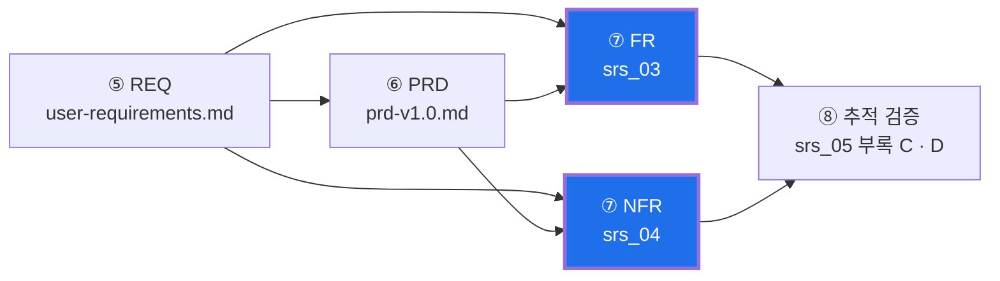

# 소프트웨어 요구사항 명세 (SRS) — 01. 개요

> **문서 코드**: `FR` · `NFR` — 건수 · ID 범위는 [README §1](../01.requirements/README.md#1-문서-지도), 개정 내역은 [srs_03](srs_03_functional_requirements.md) · [srs_04](srs_04_non_functional_requirements.md)의 「개정 이력」
> **원문**: [user-requirements.md](../01.requirements/user-requirements.md) (`REQ`) · [../02.prd/](../02.prd/README.md) (`PRD`)
> **연관**: [glossary.md](../01.requirements/glossary.md) · [todo.md](../01.requirements/todo.md) · [srs_05_appendix.md](srs_05_appendix.md)
> **작성일**: YYYY-MM-DD · **최종 개정**: YYYY-MM-DD

SRS는 `REQ`(사용자 요구사항)와 `PRD`(제품 요구사항)를 **원자적 기능 하나의 최종 상태(End Status)**로 분해한 문서다. 파이프라인 7단계의 산출물이며, 애자일 백로그가 아니라 아키텍처 설계와 구현의 입력이다. 작성 규칙의 정본은 [requirements-pipeline](../../.claude/rules/requirements-engineering/requirements-pipeline) 단계 7과 [feature-requirements](../../.claude/rules/requirements-engineering/feature-requirements)다.

---

## 1. 목적과 독자

| 항목 | 내용 |
| --- | --- |
| **목적** | 개발자와 AI가 읽고 바로 구현에 착수할 수 있는 단위로 요구를 확정한다 |
| **독자** | 개발 · QA · 아키텍처 설계자 |
| **판정 기준** | 항목 하나를 1~2분 안에 읽고 무엇을 만들지 이해할 수 있는가 |
| **상태** | <초안 / 승인 대기 / 승인> — 상위 `PRD`의 상태를 따른다 |
| **모드** | <미결 모드 — `[정의 필요]`를 부록 A에 모아 둔다 / 위임 모드 — 잠정 결정으로 채우고 재확정 조건을 단다> (파이프라인 §4.4) |

---

## 2. 이 문서가 다루는 것과 다루지 않는 것

| 다룬다 | 다루지 않는다 |
| --- | --- |
| 시스템이 갖춰야 할 기능의 최종 상태(`FR`) | 구현 수단 — 데이터베이스 · 프레임워크 · 라이브러리 · 알고리즘 |
| 유지해야 할 품질 수준과 제약(`NFR`) | 화면 레이아웃과 시각 디자인 (설계 단계) |
| 각 항목의 수용 기준(Acceptance Criteria) | 테스트 케이스 — 구현 단계에서 AC로부터 도출한다 |
| 값이 비어 있던 항목의 **잠정 결정**과 재확정 조건 | 릴리스 단계 · 우선순위 — `PRD` §9의 제안이 정본이다 |
| 상위 요구사항과의 추적 관계 | 상위 문서의 수정 — 모순을 발견하면 고치지 않고 보고한다 |

> **`PRD`가 `SRS`로 넘긴 결정 사항**: `PRD` 각 영역의 「SRS에서 결정할 것」이 이 문서의 작성 대상이다. 결정 근거와 재확정 조건은 [부록 E](srs_05_appendix.md#부록-e-결정-기록)에 모은다.

---

## 3. 상위 문서와 추적 구조

- 모든 `FR` · `NFR`은 `Related Requirements`에 근거 `REQ`를 최소 1건 가진다. 근거가 없는 항목은 만들지 않는다.
- `REQ`와 `FR`의 대응은 **다대다**다. `REQ` 하나가 원자적 기능 여러 개를 품으면 나누고, 여러 `REQ`가 한 메커니즘을 요구하면 합친다.
- `PRD` 코드는 배분 위치를 가리키는 참조이며 근거가 아니다 — 하위 문서를 상위 근거로 인용하지 않는다.
- 그림에 건수를 적지 않는다 — 건수는 요구 README §1 한 곳이다.

---

## 4. 문서 구성

| 파일 | 내용 |
| --- | --- |
| [srs_01_introduction.md](srs_01_introduction.md) | 이 문서 — 목적 · 추적 구조 · 채번 · 문체 · 검증 기준 |
| [srs_02_product_scope.md](srs_02_product_scope.md) | 제품 개요 · 역할 · 운영 환경 · 기능 영역별 `FR` 배치 · 데이터 개념 · 범위 밖 · 가정과 의존성 |
| [srs_03_functional_requirements.md](srs_03_functional_requirements.md) | 개정 이력 · 영역별 건수 · `FR` 본문 |
| [srs_04_non_functional_requirements.md](srs_04_non_functional_requirements.md) | 개정 이력 · 수치 기준의 상태 · 카테고리별 건수 · `NFR` 본문 |
| [srs_05_appendix.md](srs_05_appendix.md) | 부록 A 잠정 결정 값 · B 확인 필요 · C 추적 역색인 · D 커버리지 · E 결정 기록 |

---

## 5. 채번 규칙

| 항목 | 규칙 |
| --- | --- |
| 형식 | `FR-<3자리>` · `NFR-<3자리>`. 두 계열을 각각 연속 채번한다 |
| 순서 | 생성 순서대로 부여하고 한 번 부여한 뒤 바꾸지 않는다. 문서 내 정렬 순서와 무관하다 |
| 폐기 | 폐기 항목의 ID는 재사용하지 않는다. 삭제하지 않고 결번 양식(`## ~~FR-0nn~~`)으로 남긴다 |
| 분할 | 항목을 나누면 원래 ID를 하나가 유지하고 나머지는 새 ID를 받는다 |
| 분류 | 도메인 · 카테고리는 ID에 넣지 않고 분류 속성으로 둔다 (`NFR`은 §6의 카테고리 표기) |

> **이슈 트래커를 쓰지 않는다**: <이 저장소가 로컬 문서 기반이면 이 블록을 둔다> `feature-requirements` 템플릿의 티켓 링크는 쓰지 않으며, 의존성은 각 항목의 `의존성` 필드가 정본이다.

---

## 6. 항목 구조

모든 항목은 아래 10개 필드를 이 순서로 가진다. 내용이 없는 필드는 지우지 않고 `없음`으로 쓴다 — 누락과 "없음"을 구분하기 위함이다.

| # | 필드 | 규칙 |
| ---: | --- | --- |
| 1 | ID | `## FR-###` · `## NFR-###` 제목 |
| 2 | 제목 | ID 다음 줄 `**<명사구>**`. "시스템은 ~해야 한다" 금지. `NFR`은 `<대상> <품질 속성> <기준>` |
| 3 | 목적 | 한 문장. 누가 무엇을 위해 필요로 하는가 — "~하기 위함." |
| 4 | 기능 설명 | 불릿 3~7개. 진입 → 입력 → 동작 · 규칙 → 결과 → 제약 · 실패 순서. 라벨 없음 |
| 5 | Acceptance Criteria | 2~5개. `- [ ] <조건> 시 <관찰되는 결과>`. 외부에서 관찰 가능한 결과만. 실패 · 한도 AC 1개 이상 |
| 6 | 예외 사항 | 적용 제외 · 범위 외. 실패 동작은 여기 쓰지 않는다 |
| 7 | 상세 | 비즈니스 규칙 · 입출력 포맷 · 기술 제약 · 근거 · `**잠정 결정 YYYY-MM-DD**` 줄. `NFR`은 카테고리 표기 |
| 8 | 의존성 | 선행 `FR`/`NFR` ID와 사유 |
| 9 | Related Requirements | 근거 `REQ` 식별자. 대표 근거를 맨 앞에. 설명 문장 없음 |
| 10 | 확인 필요 | 질문 + 답에 따라 달라지는 것 |

**`NFR` 카테고리**: `PERF`(성능) `AVAIL`(가용성) `SEC`(보안) `SCALE`(확장성) `USAB`(사용성) `COMPAT`(호환성) `MAINT`(유지보수성) `COMPL`(규정준수) `OPS`(운영성)

---

## 7. 용어 기준

1. 도메인 용어는 [glossary.md](../01.requirements/glossary.md)를 유일한 기준으로 삼는다.
2. 용어집이 한국어를 표준으로 정했으면 `English(한국어)` 병기는 **영문 원형이 용어집 · 표준에 있는 경우에만** 한다(`ISO 8601` · `PDF` · `RTO` · `RPO`). 영문 표기가 없는 용어를 임의로 번역하지 않는다.
3. 역할은 역할명으로 쓴다 — <역할 목록>. "사용자"는 역할 구분이 없을 때만 쓴다.
4. 규제 · 표준은 코드 없이 명칭으로 쓴다.

---

## 8. 문체 규약

- 개조식으로 쓴다. 문장은 명사 또는 `-함` · `-됨`으로 끝낸다 — `~ 저장`, `~ 차단함`, `~ 표시됨`.
- 한 문장에 하나의 행동만 담는다. `~하고 ~함`으로 두 행동을 붙이지 않는다.
- 검증 불가능한 표현을 쓰지 않는다 — 안전하게 · 완벽하게 · 정상적으로 · 원활히 · 적절히 · 빠르게 · 등 · 필요 시.
- 수치는 상위 문서에 있는 값을 우선한다. 상위 문서에 없어 잠정으로 정한 값은 **잠정 결정** 표기와 재확정 조건을 함께 남긴다.
- 실패 동작은 `기능 설명`과 `AC`에 쓰고, `예외 사항`에는 적용 제외 · 범위 외만 쓴다.

---

## 9. 검증 기준

이 문서 묶음은 아래 검사를 통과해야 완료다. 「스크립트」 항목은 `bash scripts/check-requirements.sh`가 센다. 결과는 [부록 D](srs_05_appendix.md#부록-d-커버리지-검사)에 기록한다.

| # | 검사 항목 | 통과 기준 |
| ---: | --- | --- |
| 1 | `REQ` → `FR`/`NFR` 연결 (스크립트) | 범위 밖 · 결번을 제외한 활성 `REQ` 전건이 최소 1개 항목에 연결 |
| 2 | 제목 문체 (스크립트) | 서술형(`~해야 한다` · `~할 수 있다`) 0건 |
| 3 | 본문 문체 (스크립트) | `~합니다` · `~됩니다` 0건 · 주관 부사 0건 |
| 4 | 실패 케이스 AC | 모든 `FR`에 실패 · 제약 AC 1개 이상 |
| 5 | 기능과 수치의 분리 | 한 항목에 기능과 수치 기준이 섞인 건 0건 |
| 6 | 미확정 값 처리 | 잠정 결정으로 채우고 재확정 조건을 부록 A에 명시(위임 모드) 또는 `[정의 필요]` 전건이 부록 A에(미결 모드) |
| 7 | `확인 필요` 잔여 | 0건이 목표. 외부 답변이 필요한 건만 부록 B에 이유와 함께 존치 |
| 8 | 필드 완전성 (스크립트) | 10개 필드가 순서대로 존재 · 기능 설명 3~7 · AC 2~5 |

---

요약 : 이 문서 묶음은 `REQ`의 의무를 원자적 기능과 품질 기준으로 분해한 결과이며, 상위 문서에 없던 값은 결정 모드에 따라 `[정의 필요]` 또는 잠정 결정으로 남기고 근거를 부록 E에 둔다.
