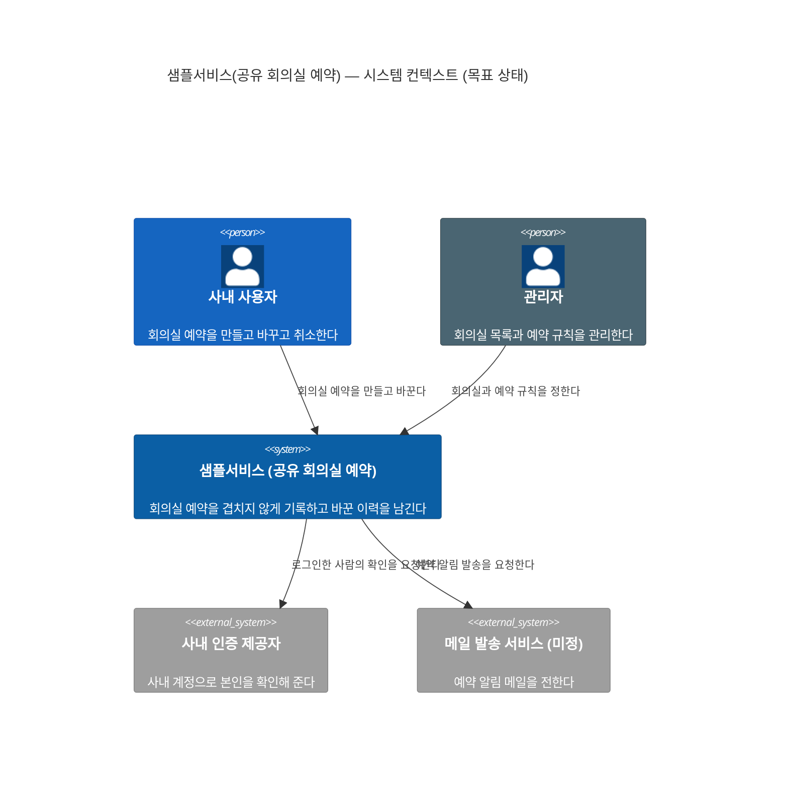

# C4 시스템 컨텍스트 다이어그램 — 샘플서비스(공유 회의실 예약) · 목표 상태

> **골격** — 이 문서는 템플릿 견본이다. 예시 도메인은 「공유 회의실 예약」이고 Person · 외부 시스템은 **예시**다. 실제 SRS가 승인되면 요소를 SRS 근거로 다시 정하고 이 배너를 지운다.
>
> 개정 배너 형식(최신이 위 · 누적 · 지우지 않음) — `> **개정 <YYYY-MM-DD> (<기능>)** — <무엇을 바꿨는지> · 근거 <D-n · FR-###>`

> **문서 코드**: `CTX`
> **상위 문서**: [srs_02_product_scope.md](../../../03.srs/srs_02_product_scope.md) · [srs_03_functional_requirements.md](../../../03.srs/srs_03_functional_requirements.md) · [srs_04_non_functional_requirements.md](../../../03.srs/srs_04_non_functional_requirements.md)
> **하위 문서**: [02_c4_container.md](02_c4_container.md) → [03_c4_component.md](03_c4_component.md)
> **작성 규칙**: [.claude/rules/architecture-diagram/context-diagram](../../../../.claude/rules/architecture-diagram/context-diagram)
> **상태**: 목표 상태 (골격)
> **작성일**: <YYYY-MM-DD>

시스템 컨텍스트는 **샘플서비스가 누구를 위해 무엇을 하며 무엇에 의존하는지**를 한 장으로 고정하는 문서다. 시스템 내부 구성은 [02_c4_container](02_c4_container.md)가 담당하며, 이 문서에는 컨테이너 · DB · 인프라를 그리지 않는다.

---

## 1. 시스템 컨텍스트 다이어그램

> **범례** — Mermaid C4는 범례를 그리지 않으므로 색의 뜻을 표로 대신한다.
>
> | 색 | 뜻 |
> | --- | --- |
> | 짙은 파랑 `#1565C0` | 업무 화면을 쓰는 역할 |
> | 회청색 `#4A6572` | 관리 역할 |
> | 파랑 `#0B5FA5` | 대상 시스템 |
> | 회색 `#9E9E9E` | 외부 시스템 — 우리 소유가 아님 |

---

## 2. 요소 목록

### 2.1 대상 시스템

| 이름 | 유형 | 책임 | 소유 |
| --- | --- | --- | --- |
| 샘플서비스 (공유 회의실 예약) | Software System | 회의실 예약을 기록 · 변경 · 취소하고 변경 이력을 남긴다. 회의실 출입 통제 · 화상 회의는 책임 밖이다 | 우리 |

### 2.2 Person

| 이름 | 책임 | 대상 시스템과의 관계 | 주 대상 `FR` |
| --- | --- | --- | --- |
| 사내 사용자 | 회의실 예약을 만들고 바꾸고 취소하며 이력을 본다 | 회의실 예약을 만들고 바꾼다 | `FR-001`~`FR-005` (예시) |
| 관리자 | 회의실 목록과 예약 규칙(예약 단위 · 최대 길이)을 관리한다 | 회의실과 예약 규칙을 정한다 | <FR-###> |

Person을 둘로 그린 근거는 **권한이 다르기 때문**이다. 접근 경로가 같아도 권한이 다르면 별도 Person이다.

### 2.3 외부 시스템

| 이름 | 유형 | 책임 | 대상 시스템과의 관계 | 근거 `FR`·`NFR` |
| --- | --- | --- | --- | --- |
| 사내 인증 제공자 | Software System | 사내 계정으로 본인을 확인한다 | 로그인 때 대상 시스템이 확인을 요청한다 | <FR-###> |
| 메일 발송 서비스 (미정) | Software System | 메일을 받는 사람에게 전한다 | 예약 시작 전 알림을 보낼 때 대상 시스템이 발송을 요청한다 | <FR-###> |

---

## 3. 넣지 않은 것과 그 이유

| 후보 | 판정 | 이유 |
| --- | --- | --- |
| 업무 데이터베이스 | 대상 시스템 내부 | 우리 배포에 포함된 구성 요소는 외부 시스템이 아니다 |
| 진입점 · 로드밸런서 | 그리지 않음 | 인프라 요소는 [07_deployment_architecture](07_deployment_architecture.md)의 몫이다 |
| 회의 참석자(예약하지 않고 참석만 하는 사람) | 그리지 않음 | 시스템과 직접 상호작용하지 않는 이해관계자다 |
| 외부 달력 서비스 | 그리지 않음 | 근거 FR이 없다. 업종에서 흔하다는 이유로 넣지 않는다 |

---

## 4. 가정 및 확인 필요

| # | 항목 | 내용 | 확정 시점 |
| ---: | --- | --- | --- |
| A-1 | 메일 발송 수단 | 역할명으로만 그렸다. 수단이 정해지면 괄호에 적는다 | 계약 · 스택 확정 시 |
| A-2 | 관리자 · 외부 시스템의 FR | 견본이라 FR 번호를 비워 두었다. SRS가 승인되면 채운다 | SRS 승인 시 |

---

## 5. 자체 점검

| # | 점검 항목 | 결과 |
| ---: | --- | :--: |
| 1 | 대상 시스템이 박스 1개이고 내부 구성이 새어 나오지 않았는가 | ✅ |
| 2 | 모든 Person이 역할 단위이며 권한 · 목적 · 접근 경로 중 하나 이상이 다른가 | ✅ |
| 3 | 모든 외부 시스템이 우리 소유가 아니며 대상 시스템과 직접 통신하는가 | ✅ |
| 4 | 모든 화살표에 업무 용어 동사구가 있고 기술 용어가 없는가 | ✅ |
| 5 | 근거 없는 액터 · 외부 시스템을 추가하지 않았는가 | ✅ §3 |
| 6 | 현행 상태와 목표 상태를 섞지 않았는가 | ✅ 제목에 목표 상태 |
| 7 | 박스가 15개 이하인가 · 집합이 하위 문서와 맞는가 | ✅ `scripts/check-diagrams.sh` 통과 |

요약 : 샘플서비스는 **사내 사용자 · 관리자 둘이 쓰고 외부 시스템 둘(인증 · 메일)에 기댄다**. 견본이므로 FR 근거는 SRS 승인 뒤 채운다.
