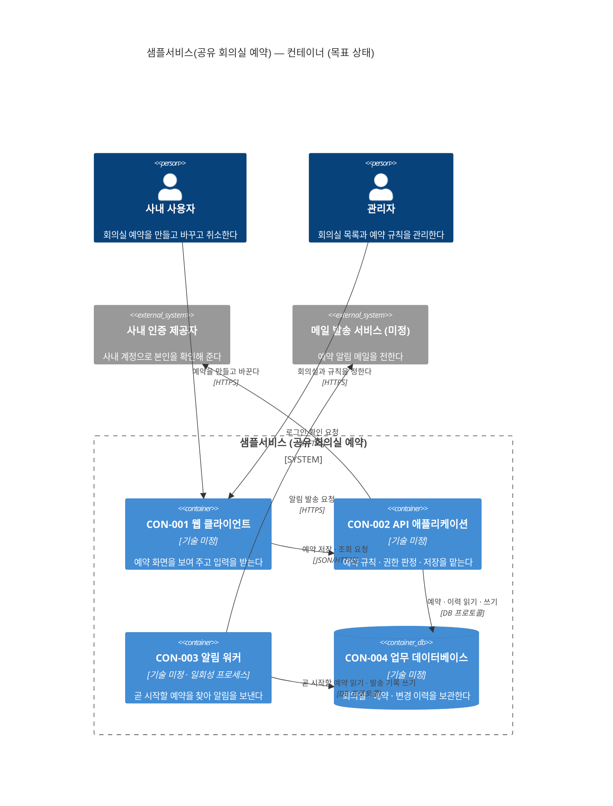

# C4 컨테이너 다이어그램 — 샘플서비스(공유 회의실 예약) · 목표 상태

> **골격** — 컨테이너는 「공유 회의실 예약」 **예시**다. 기술 칸은 일부러 비웠다 — 이 템플릿은 스택을 정하지 않는다. 스택을 고르면 ADR을 쓰고 기술 칸을 채운다.

> **문서 코드**: `CON` — `CON-###`
> **상위 문서**: [01_c4_context.md](01_c4_context.md) (Person · 외부 시스템을 그대로 가져왔다)
> **하위 문서**: [03_c4_component.md](03_c4_component.md) · [07_deployment_architecture.md](07_deployment_architecture.md)
> **작성 규칙**: [.claude/rules/architecture-diagram/container-component-diagram](../../../../.claude/rules/architecture-diagram/container-component-diagram)
> **상태**: 목표 상태 (골격)
> **작성일**: <YYYY-MM-DD>

컨테이너 다이어그램은 **따로 배포 · 실행되는 단위와 그 사이의 통신**을 고정하는 문서다. 컨테이너 안의 모듈 경계는 [03_c4_component](03_c4_component.md)가, 어디에 몇 개가 도는지는 [07_deployment_architecture](07_deployment_architecture.md)가 담당한다.

---

## 1. 컨테이너 다이어그램

---

## 2. 컨테이너 목록

| ID | 이름 | 유형 | 책임 | 기술 | 근거 `FR`·`NFR` |
| --- | --- | --- | --- | --- | --- |
| `CON-001` | 웹 클라이언트 | 클라이언트 애플리케이션 | 예약 화면을 보여 주고 입력을 받는다. 업무 규칙을 두지 않는다 | 미정 | `FR-001`~`FR-005` (예시) |
| `CON-002` | API 애플리케이션 | 서버 애플리케이션 | 인증 확인 · 권한 판정 · 예약 규칙 · 저장. 무상태 | 미정 | `FR-001`~`FR-005` (예시) |
| `CON-003` | 알림 워커 | 일회성 프로세스 | 정해진 주기로 떠서 곧 시작할 예약의 알림을 보내고 끝난다. 실패하면 0이 아닌 코드로 끝난다 | 미정 | <FR-###> |
| `CON-004` | 업무 데이터베이스 | 저장소 | 회의실 · 예약 · 변경 이력 · 알림 발송 기록 | 미정 | <NFR-###> |

**컨테이너를 나눈 근거** — `CON-003`을 `CON-002`와 나눈 이유는 실행 주기가 다르고(요청 대기 vs 주기 실행) 메일 발송 지연이 예약 저장 응답 시간에 섞이면 안 되기 때문이다.

## 3. 관계 목록

| # | 출발 | 도착 | 의도 | 통신 | 동기 |
| ---: | --- | --- | --- | --- | :--: |
| 1 | 사내 사용자 · 관리자 | `CON-001` | 화면을 쓴다 | HTTPS | 동기 |
| 2 | `CON-001` | `CON-002` | 예약 저장 · 조회 요청 | JSON/HTTPS | 동기 |
| 3 | `CON-002` | `CON-004` | 예약 · 이력 읽기 · 쓰기 | DB 프로토콜 | 동기 |
| 4 | `CON-002` | 사내 인증 제공자 | 로그인 확인 요청 | HTTPS | 동기 |
| 5 | `CON-003` | `CON-004` | 곧 시작할 예약 읽기 · 발송 기록 쓰기 | DB 프로토콜 | 동기 |
| 6 | `CON-003` | 메일 발송 서비스 | 알림 발송 요청 | HTTPS | 동기 |

---

## 4. 넣지 않은 것과 그 이유

| 후보 | 판정 | 이유 |
| --- | --- | --- |
| 메시지 큐 | 그리지 않음 | 알림은 워커가 DB를 읽어 보낸다. 큐를 요구하는 NFR이 없다 |
| 캐시 | 그리지 않음 | 근거 NFR(응답 시간 목표)이 아직 없다 |
| 진입점 · 로드밸런서 | 그리지 않음 | 배포 다이어그램의 몫이다 |

## 5. 가정 및 확인 필요

| # | 항목 | 내용 | 확정 시점 · 영향 |
| ---: | --- | --- | --- |
| A-1 | 기술 스택 | 전 컨테이너의 기술 칸이 「미정」이다 | 스택 ADR 채택 시 — 이 표와 그림의 기술 칸을 채운다 |
| A-2 | 알림 중복 | 워커가 중간에 죽고 다시 뜨면 같은 알림을 두 번 보낼 수 있다. 발송 기록으로 멱등하게 만든다고 가정했다 | SRS의 알림 FR 확정 시 |

## 6. 경고

- `CON-003` → `CON-004` 직접 접근은 `CON-002`의 권한 판정을 지나지 않는다. 워커가 쓰는 범위를 「발송 기록」으로 한정한다 — 고치지 않고 기록한다. 범위를 넓히는 결정은 사람의 몫이다.

## 7. 자체 점검

| # | 점검 항목 | 결과 |
| ---: | --- | :--: |
| 1 | Person · 외부 시스템이 01과 이름까지 같은가 | ✅ |
| 2 | 컨테이너마다 책임이 하나이고 이름에 역할이 드러나는가 | ✅ |
| 3 | 모든 관계에 의도와 통신 방식이 있는가 | ✅ §3 |
| 4 | 컨테이너를 나눈 근거가 있는가 | ✅ §2 |
| 5 | 집합이 하위 문서와 맞는가 | ✅ `scripts/check-diagrams.sh` 통과 |

요약 : 컨테이너는 **클라이언트 1 · 서버 1 · 주기 실행 1 · 저장소 1로 네 개**다. 기술은 스택 ADR이 채운다.
