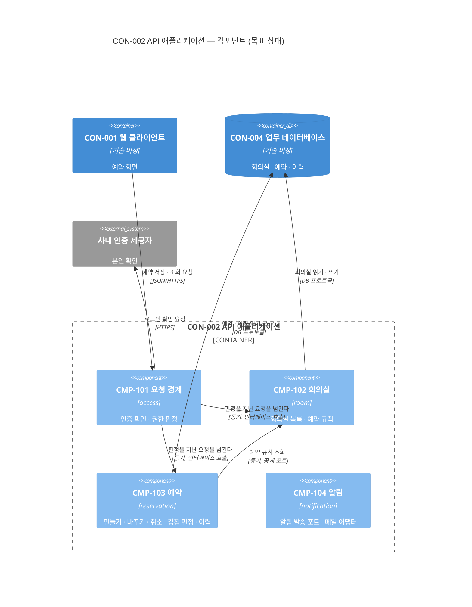

# C4 컴포넌트 다이어그램 — `CON-002` API 애플리케이션 · 목표 상태

> **골격** — 컴포넌트는 「공유 회의실 예약」 **예시**다.

> **문서 코드**: `CMP-1xx`
> **상위 문서**: [02_c4_container.md](02_c4_container.md) · 목차 [03_c4_component.md](03_c4_component.md) (매핑표 · 커버리지 정본)
> **작성 규칙**: [container-component-diagram](../../../../.claude/rules/architecture-diagram/container-component-diagram) · [component-package-mapping](../../../../.claude/rules/architecture-diagram/component-package-mapping)
> **상태**: 목표 상태 (골격)
> **작성일**: <YYYY-MM-DD>

이 문서는 **API 애플리케이션 안의 모듈 경계와 의존 방향**을 고정한다. 모듈 안의 계층 · 클래스는 그리지 않는다 — 코드 수준 설계는 구현의 몫이다.

---

## 1. 컴포넌트 다이어그램

---

## 2. 컴포넌트 목록

| ID | 이름 | 책임 | 공개 포트 | 근거 `FR` |
| --- | --- | --- | --- | --- |
| `CMP-101` | 요청 경계 | 모든 요청의 인증 확인 · 권한 판정. 업무 규칙을 두지 않는다 | 권한 판정 | <FR-###> |
| `CMP-102` | 회의실 | 회의실 목록 · 예약 규칙 | 회의실 · 규칙 조회 | <FR-###> |
| `CMP-103` | 예약 | 예약 만들기 · 바꾸기 · 취소 · 겹침 판정 · 변경 이력 | 곧 시작할 예약 조회 | `FR-001`~`FR-005` (예시) |
| `CMP-104` | 알림 | 알림 발송 포트. 메일 어댑터는 이 안에만 있다 | 알림 발송 | <FR-###> |

## 3. 의존 규칙

| # | 규칙 | 지키는 검사 |
| ---: | --- | --- |
| 1 | 의존은 `CMP-101` → 업무 컴포넌트 한 방향이다. 업무 컴포넌트는 요청 경계를 부르지 않는다 | `AR-02` (스택을 고른 뒤 검사로 만든다 — 그 전까지는 리뷰) |
| 2 | `CMP-103`은 `CMP-102`의 공개 포트로만 규칙을 읽는다. 저장 구현을 직접 참조하지 않는다 | `AR-01` |
| 3 | 메일 벤더 SDK는 `CMP-104` 밖에서 참조하지 않는다 | `AR-04` |
| 4 | `CMP-103`의 저장 경로는 `CMP-104`를 부르지 않는다 — 알림은 `CON-003`이 따로 보낸다 | 리뷰 |

## 4. 넣지 않은 것과 그 이유

| 후보 | 판정 | 이유 |
| --- | --- | --- |
| 계층(`domain` · `application` …) | 그리지 않음 | 계층은 컴포넌트 안의 구조다. 박스로 그리면 컴포넌트 경계가 흐려진다 |
| `shared` 모듈 | 그리지 않음 | 컴포넌트가 아니다([03](03_c4_component.md) §2) |
| 감사 기록 컴포넌트 | 그리지 않음 | 근거 FR이 없다 |

## 5. 가정 · 경고 · 자체 점검

| # | 항목 | 내용 |
| ---: | --- | --- |
| A-1 | 알림 컴포넌트의 위치 | `CMP-104`는 API 모듈에 있고 `CON-003`이 빌려 쓴다고 가정했다. 빌려 쓰는 모듈 목록이 계약이다 |
| 경고 | `CON-003`의 DB 접근 | 워커는 `CMP-103`의 공개 포트(곧 시작할 예약 조회)로만 읽는다. 표를 직접 읽으면 겹침 판정 · 이력 규칙을 우회한다 |
| 점검 | 박스 15개 이하 · `CMP` 집합이 03과 같음 | ✅ `scripts/check-diagrams.sh` 통과 |

요약 : API 안의 의존은 **요청 경계 → 업무 컴포넌트 → 저장소** 한 방향이고, 외부 발송은 저장 경로 밖에 있다.
