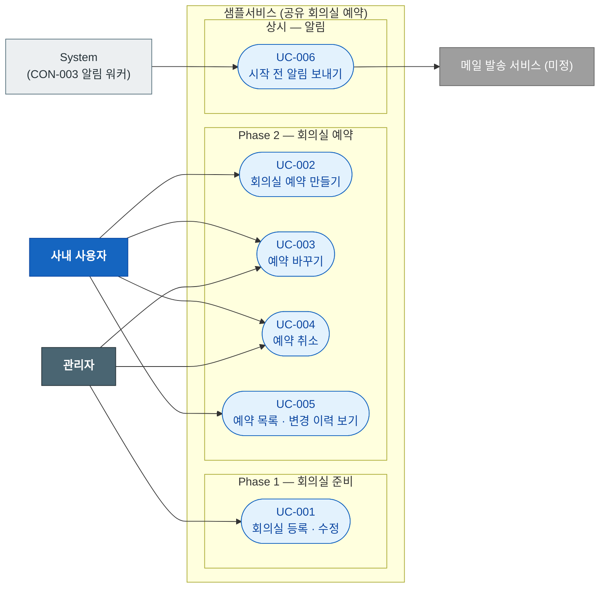

# UML 유스케이스 다이어그램 — 샘플서비스(공유 회의실 예약)

> **골격** — UC는 「공유 회의실 예약」 **예시**다. 실제 프로젝트는 SRS · C4에서 다시 도출한다.

> **문서 코드**: `UC` — `UC-###`
> **상위 문서**: [01_c4_context.md](01_c4_context.md) (액터 정본) · [02_c4_container.md](02_c4_container.md) (외부 시스템 정본) · [03_c4_component.md](03_c4_component.md) (`CMP` 대응)
> **하위 문서**: [05_use_case_scenarios.md](05_use_case_scenarios.md) (상세 시나리오) · [06_activity_diagram.md](06_activity_diagram.md) (흐름 정본)
> **작성 규칙**: [.claude/rules/architecture-diagram/usecase](../../../../.claude/rules/architecture-diagram/usecase)
> **상태**: 목표 상태 (골격)
> **작성일**: <YYYY-MM-DD>

유스케이스는 **액터가 시스템으로부터 얻는 관찰 가능한 목표 하나**를 단위로 한다. 이 문서는 액터 집합 · UC 인덱스 · 연결 관계 다이어그램 · 공통 사전조건을 담고, UC별 정의와 실패 케이스는 [05_use_case_scenarios](05_use_case_scenarios.md)가 가리키는 Phase 문서가 담는다. 순서와 분기는 [06_activity_diagram](06_activity_diagram.md)의 몫이다.

**액터는 발명하지 않았다** — [01_c4_context](01_c4_context.md)의 Person만 쓴다. `FR`에 근거가 없는 UC는 만들지 않는다.

---

## 1. 액터와 권한 분리선

| # | 액터 | 유형 | 주요 접근 화면 | 담당 UC |
| ---: | --- | --- | --- | --- |
| 1 | 사내 사용자 | Person | 회의실 예약 | `UC-002`~`UC-005` |
| 2 | 관리자 | Person (관리) | 회의실 관리 · 회의실 예약 | `UC-001`~`UC-005` |
| 3 | System | 시스템 주체(`CON-003`) | — | `UC-006` |

### 1.1 역할별 권한 분리선

| 액터 | 전권 | 금지 |
| --- | --- | --- |
| 사내 사용자 | 자기 예약의 생성 · 변경 · 취소, 모든 예약의 조회 | 남의 예약 변경 · 취소, 회의실 · 규칙 변경 |
| 관리자 | 회의실 · 예약 규칙, 모든 예약의 변경 · 취소 | 예약 이력의 수정 · 삭제 |

> **가장 큰 사고 지점은 관리자 행이다.** 관리자는 남의 예약을 바꿀 수 있지만, 그 변경도 이력에 행위자와 함께 남는다. 이력은 누구도 고치지 못한다.

## 2. 유스케이스 인덱스

### Phase 1 — 회의실 준비

| ID | UC 이름 | 주 액터 | 근거 `FR` | 대응 `CMP` | 구현 상태 |
| --- | --- | --- | --- | --- | --- |
| `UC-001` | 회의실 등록 · 수정 | 관리자 | <FR-###> | `CMP-102` `CMP-101` | 계획 |

### Phase 2 — 회의실 예약

| ID | UC 이름 | 주 액터 | 근거 `FR` | 대응 `CMP` | 구현 상태 |
| --- | --- | --- | --- | --- | --- |
| `UC-002` | 회의실 예약 만들기 | 사내 사용자 | `FR-001` | `CMP-103` `CMP-102` `CMP-101` | 계획 |
| `UC-003` | 예약 바꾸기 | 사내 사용자 | `FR-002` | `CMP-103` | 계획 |
| `UC-004` | 예약 취소 | 사내 사용자 | `FR-003` | `CMP-103` | 계획 |
| `UC-005` | 예약 목록 · 변경 이력 보기 | 사내 사용자 | `FR-004` `FR-005` | `CMP-103` | 계획 |

### 상시 — 알림

| ID | UC 이름 | 주 액터 | 근거 `FR` | 대응 `CMP` | 구현 상태 |
| --- | --- | --- | --- | --- | --- |
| `UC-006` | 시작 전 알림 보내기 | System | <FR-###> | `CMP-104` `CMP-103` | 계획 |

## 3. Use Case Diagram

> **표기 범례** — 실선 화살표는 액터가 UC를 시작하거나 결과를 받는다는 뜻이다. `«include»` · `«extend»`는 Phase 문서의 흐름에 「→ UC-###」 참조가 있는 쌍만 점선으로 긋는다(이 견본에는 없다). 회색 사각형은 외부 시스템이다.

## 4. 공통 사전조건

모든 UC(`UC-006` 제외)는 아래를 통과한 뒤 시작한다. UC마다 되풀이해 적지 않는다.

| # | 조건 | 통과하지 못하면 |
| ---: | --- | --- |
| 1 | 사내 인증 제공자가 본인을 확인했다 | 로그인 화면으로 보낸다 |
| 2 | 요청 경계(`CMP-101`)가 그 화면 · 그 동작의 권한을 확인했다 | 거부하고 이유를 보인다. 남의 예약을 바꾸려 하면 없는 예약과 같은 응답을 준다 |

## 5. 넣지 않은 것 · 가정 · 자체 점검

| 구분 | 항목 | 내용 |
| --- | --- | --- |
| 넣지 않음 | 반복 예약 | 근거 FR이 없다. `docs/01.requirements/todo.md` 의 범위 질문으로 남는다 |
| 넣지 않음 | 로그인 | 목표가 아니라 사전조건이다(§4) |
| A-1 | `UC-001` · `UC-006`의 FR | 견본이라 비워 두었다. SRS 승인 뒤 채운다 |
| 점검 | 액터 ⊆ 01 · UC 집합 = 05 · 06 ⊆ 04 | ✅ `scripts/check-diagrams.sh` 통과 |

요약 : UC는 **준비 1 · 예약 4 · 상시 1로 여섯 개**이고, 액터는 01의 Person 둘과 시스템 주체 하나다.
