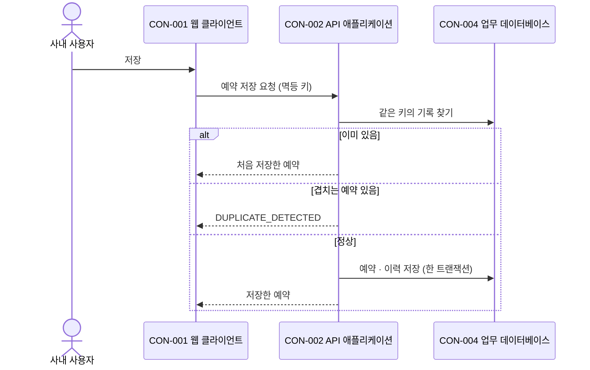

# Phase 2 — 회의실 예약 · 상시 알림 — 상세 시나리오

> **목차**: [05_use_case_scenarios.md](05_use_case_scenarios.md) — UC 절의 구성 · 확인 필요는 목차 문서가 정본이다
> **연관**: [04_use_case_diagram.md](04_use_case_diagram.md) (UC 인덱스 · 공통 사전조건) · [06_activity_diagram.md](06_activity_diagram.md) (흐름 정본) · [10_sequence_reservation.md](10_sequence_reservation.md) (시퀀스)
> **상태**: 목표 상태 (골격 — 예시)
> **작성일**: <YYYY-MM-DD>

## 사용자 시나리오 (선택 절)

월요일 아침, 예시회사의 홍길동은 오후 회의를 위해 「회의실 A」를 14시부터 15시까지 잡는다. 지하철에서 저장을 눌렀는데 응답이 늦어 한 번 더 눌렀지만 예약은 하나만 생긴다. 점심 뒤 회의가 30분 늘어 끝 시각을 바꾸려는데, 그사이 관리자가 목적을 고쳐 둔 탓에 「다른 사람이 먼저 바꿨어요」 안내와 함께 바뀐 칸이 보인다. 다시 열어 끝 시각만 고친다.

## `UC-002` · 회의실 예약 만들기

| 항목 | 내용 |
| --- | --- |
| **주 액터** | 사내 사용자 |
| **사전조건** | 공통 사전조건(04 §4)을 통과했다. 회의실이 등록돼 있다(`UC-001`) |
| **사후조건** | 예약이 `ACTIVE`로 저장되고 이력에 `CREATED` 한 줄이 남는다 |
| **대응 `CMP`** | `CMP-103` `CMP-102` `CMP-101` |
| **근거 `FR`** | `FR-001` (예시) |
| **인터페이스** | 예약 저장 — 요청마다 멱등 키를 싣는다 |

**주 흐름 (목표)**

1. 사내 사용자가 회의실 · 시작 · 끝 시각 · 목적을 입력하고 저장한다.
2. 화면이 이 저장에 고유 번호(멱등 키)를 붙여 보낸다.
3. 시스템이 끝 시각 > 시작 시각 · 예약 단위 · 최대 길이 · 목적 0~200자를 검사한다.
4. 시스템이 같은 회의실에 겹치는 진행 중 예약이 없는지 보고 저장한다.
5. 시스템이 이력에 `CREATED`를 추가하고 저장한 예약을 돌려준다.

**실패 케이스**

| 조건 | 시나리오 (사내 사용자 관점) | 대응 `FR`·`NFR` |
| --- | --- | --- |
| 같은 고유 번호로 다시 보냄(응답 유실 · 두 번 누름) | 새로 만들지 않고 처음 저장한 예약을 그대로 받는다 | `FR-001` |
| 고유 번호 없이 보냄 | 거부된다(`VALIDATION_FAILED`) | `FR-001` |
| 같은 회의실 · 겹치는 시간 | 거부되고 겹친다는 안내가 보인다(`DUPLICATE_DETECTED`). 동시에 들어온 두 요청 중 늦은 쪽도 같은 거부를 받는다 | `FR-001` |
| 끝 시각이 시작 시각보다 이르거나 같음 | 거부되고 칸 옆에 이유가 보인다 | `FR-001` |
| 지운 회의실 | 거부된다. 목록에 없으므로 화면에서는 고를 수 없다 | `FR-001` |

## `UC-003` · 예약 바꾸기

| 항목 | 내용 |
| --- | --- |
| **주 액터** | 사내 사용자 (자기 예약) · 관리자 (모든 예약) |
| **사전조건** | 바꿀 예약을 열어 버전을 알고 있다 |
| **사후조건** | 보낸 칸만 바뀌고 버전이 하나 오르며 이력에 `UPDATED`와 바뀐 칸의 전 · 후 값이 남는다 |
| **대응 `CMP`** | `CMP-103` |
| **근거 `FR`** | `FR-002` (예시) |
| **인터페이스** | 예약 고치기 — 요청마다 연 버전을 싣는다 |

**주 흐름 (목표)**

1. 사용자가 예약을 열어 칸을 고치고 저장한다.
2. 화면이 열었을 때의 버전을 함께 보낸다.
3. 시스템이 버전이 그대로인지 확인하고, 시각이 바뀌었으면 겹침을 다시 본다.
4. 시스템이 칸을 바꾸고 버전을 올리고 이력에 `UPDATED`를 추가한다.

**실패 케이스**

| 조건 | 시나리오 (사용자 관점) | 대응 `FR`·`NFR` |
| --- | --- | --- |
| 그사이 다른 사람이 바꿈(버전 다름) | 거부되고 사이에 바뀐 칸이 보인다(`VERSION_CONFLICT`). 다시 열어 고친다 — 시스템이 대신 합치지 않는다 | `FR-002` |
| 버전 없이 보냄 | 거부된다 | `FR-002` |
| 바꾼 시각이 다른 예약과 겹침 | 거부되고 겹친다는 안내가 보인다 | `FR-002` |
| 남의 예약을 바꾸려 함(사내 사용자) | 없는 예약과 같은 응답을 받는다 | `FR-002` |

## `UC-004` · 예약 취소

| 항목 | 내용 |
| --- | --- |
| **주 액터** | 사내 사용자 (자기 예약) · 관리자 (모든 예약) |
| **사후조건** | 예약이 `CANCELLED`가 되고 행은 남는다. 이력에 `CANCELLED`와 사유가 남는다. 그 시간대는 다시 예약할 수 있다 |
| **대응 `CMP`** | `CMP-103` |
| **근거 `FR`** | `FR-003` (예시) |

**실패 케이스**

| 조건 | 시나리오 (사용자 관점) | 대응 `FR`·`NFR` |
| --- | --- | --- |
| 이미 취소된 예약을 다시 취소 | 같은 결과를 그대로 받는다. 이력이 두 줄 생기지 않는다 | `FR-003` |
| 취소한 예약을 되살리려 함 | 되살리는 기능은 없다. 새로 예약한다 | `FR-003` |

## `UC-005` · 예약 목록 · 변경 이력 보기

| 항목 | 내용 |
| --- | --- |
| **주 액터** | 사내 사용자 |
| **사후조건** | 고른 기간의 예약 목록과, 예약 하나의 변경 이력(누가 · 언제 · 무엇을)이 보인다 |
| **대응 `CMP`** | `CMP-103` |
| **근거 `FR`** | `FR-004` `FR-005` (예시) |

**실패 케이스**

| 조건 | 시나리오 (사내 사용자 관점) | 대응 `FR`·`NFR` |
| --- | --- | --- |
| 기간에 예약이 없음 | 빈 목록과 「예약이 없어요」 안내가 보인다. 오류가 아니다 | `FR-004` |
| 없는 예약 번호 | 없다는 안내가 보인다 | `FR-005` |

## `UC-006` · 시작 전 알림 보내기

| 항목 | 내용 |
| --- | --- |
| **주 액터** | System (`CON-003` 알림 워커 — 정해진 주기로 뜬다) |
| **사후조건** | 곧 시작할 예약마다 예약자에게 알림이 한 번 가고 발송 기록이 남는다 |
| **대응 `CMP`** | `CMP-104` `CMP-103` |
| **근거 `FR`** | <FR-###> |

**실패 케이스**

| 조건 | 시나리오 | 대응 `FR`·`NFR` |
| --- | --- | --- |
| 메일 발송 서비스가 실패를 돌려줌 | 발송 기록에 실패로 남기고 워커는 0이 아닌 코드로 끝난다. 보낸 척 성공을 기록하지 않는다 | <FR-###> |
| 워커가 중간에 죽고 다시 뜸 | 발송 기록이 있는 예약은 건너뛴다. 같은 알림이 두 번 가지 않는다 | <FR-###> |
| 메일 발송 설정(키)이 없음 | 알림 기능이 꺼진 채로 뜨고, 관리 화면에 「연결 전」이 보인다 | <FR-###> |
| 알림 직전에 취소된 예약 | 보내지 않는다 | <FR-###> |
