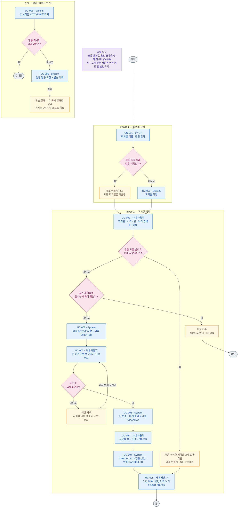

# 전체 워크플로우 Activity Diagram — 샘플서비스(공유 회의실 예약)

> **골격** — 흐름은 「공유 회의실 예약」 **예시**다. 실제 UC가 정해지면 Phase를 다시 그린다.

> **정본(source of truth)**: 이 문서의 §2 Mermaid 블록. **흐름 수정은 여기서만 한다**
> **상위 문서**: [04_use_case_diagram.md](04_use_case_diagram.md) (UC 집합) · [02_c4_container.md](02_c4_container.md) (컨테이너 이름)
> **작성 규칙**: [.claude/rules/architecture-diagram/activity-diagram](../../../../.claude/rules/architecture-diagram/activity-diagram)
> **상태**: 목표 상태 (골격)
> **작성일**: <YYYY-MM-DD>

Activity Diagram은 **UC들을 시간 순서 · 분기 · 예외로 엮은 흐름**이다. UC 하나하나의 정의와 실패 케이스 상세는 [05_use_case_scenarios](05_use_case_scenarios.md)가 가리키는 문서가 담당한다.

---

## 1. 레인과 표기

Mermaid `flowchart`에는 swimlane이 없다. 레인은 **노드 라벨의 액터 태그**로 표기하고, Phase는 `subgraph`로 구획한다. 액터 이름은 [01_c4_context](01_c4_context.md)의 Person 그대로다.

| 노드 색 | 뜻 |
| --- | --- |
| 파랑 | 정상 활동 |
| 노랑 | 예외 · 오류 · 재시도 · 사람 보정 |
| 분홍 마름모 | 분기 |

---

## 2. 전체 워크플로우 (정본)

---

## 3. Phase 정의

Phase 이름은 [04_use_case_diagram](04_use_case_diagram.md) §2와 **문자 그대로 같다**.

| Phase | 이름 | 포함 UC | 시작 조건 | 종료 상태 |
| :--: | --- | --- | --- | --- |
| 1 | 회의실 준비 | `UC-001` | 관리자가 로그인 | 예약할 수 있는 회의실이 있음 |
| 2 | 회의실 예약 | `UC-002`~`UC-005` | 사내 사용자가 로그인 | 예약이 `ACTIVE` 또는 `CANCELLED`이고 변경이 이력에 남음 |
| 상시 | 알림 | `UC-006` | 정해진 주기 | 곧 시작할 예약마다 알림이 한 번 감 |

순차 위치가 없는 활동(주기 작업 · 상시 조회)은 Phase로 줄 세우지 않고 별도 `subgraph`(「상시 — <이름>」)로 그린다.

## 4. 예외 분기 목록

| # | 분기 | 조건 | 처리 | 근거 |
| ---: | --- | --- | --- | --- |
| 1 | `P1_D1` | 지운 회의실과 같은 이름 | 되살린다 — 새 행을 만들지 않는다 | `.claude/rules/product-judgement` §2 |
| 2 | `P2_D1` | 같은 고유 번호의 재전송 | 처음 결과를 돌려준다 | `FR-001` |
| 3 | `P2_D2` | 겹치는 예약 | 거부한다 | `FR-001` |
| 4 | `P2_D3` | 버전 다름 | 거부하고 바뀐 칸을 보인다. 사람이 다시 연다 | `FR-002` |
| 5 | `AL_D1` | 이미 보낸 알림 | 건너뛴다 | <FR-###> |

## 5. 가정 · 자체 점검

| # | 항목 | 내용 |
| ---: | --- | --- |
| A-1 | 알림 시점 | 「곧」의 기준(시작 몇 분 전)이 FR에 없다. 수치를 발명하지 않고 비워 두었다 |
| 점검 | 흐름 정본 블록이 하나 · UC가 전부 04에 있음 | ✅ `scripts/check-diagrams.sh` 통과 |
| 점검 | 수치(재시도 횟수 · 기한)에 FR 번호가 있는가 | ✅ 수치 없음 |

요약 : 흐름은 **준비 → 예약 → 조회** 한 줄기와 주기로 도는 알림 하나이고, 분기 다섯 곳이 모두 「새로 만들지 않는다 · 거부한다 · 건너뛴다」 중 하나로 끝난다.
