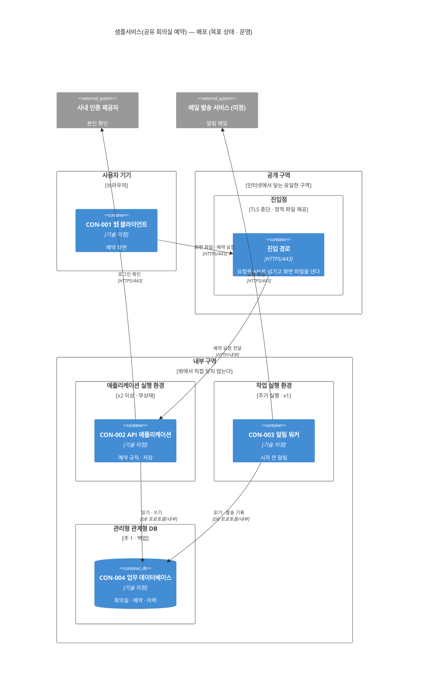

# 배포 아키텍처 — 샘플서비스(공유 회의실 예약) · 목표 상태 · 운영 환경

> **골격** — 노드는 **벤더 중립 유형**으로만 적었다. 이 템플릿은 클라우드 · 실행 도구를 정하지 않는다. 인프라를 고르면 ADR을 쓰고 §4 벤더 대응표를 채운다.

> **문서 코드**: `DEP`
> **상위 문서**: [02_c4_container.md](02_c4_container.md) (컨테이너를 그대로 가져왔다) · [srs_04_non_functional_requirements.md](../../../03.srs/srs_04_non_functional_requirements.md)
> **하위 문서**: 인프라 코드(스택을 고른 뒤)
> **작성 규칙**: [.claude/rules/architecture-diagram/deployment-diagram](../../../../.claude/rules/architecture-diagram/deployment-diagram)
> **상태**: 목표 상태 (골격)
> **작성일**: <YYYY-MM-DD>

배포 아키텍처는 **컨테이너가 어디에 몇 개, 어떤 네트워크 경계 안에서 도는지**를 고정하는 문서다. 컨테이너의 책임은 02가 정본이고, 여기서는 새 컨테이너를 만들지 않는다.

---

## 1. 배포 다이어그램

---

## 2. 컨테이너 ↔ 배포 노드 대응

활성 `CON` 전건이 이 표에 있어야 한다(`scripts/check-diagrams.sh`).

| CON | 이름 | 배포 노드 | 인스턴스 | 구역 | 근거 `NFR` |
| --- | --- | --- | --- | --- | --- |
| `CON-001` | 웹 클라이언트 | 사용자 기기(파일은 진입점이 제공) | 사용자마다 | 밖 | <NFR-###> |
| `CON-002` | API 애플리케이션 | 애플리케이션 실행 환경 | 2 이상 | 내부 | <NFR-###> |
| `CON-003` | 알림 워커 | 작업 실행 환경 | 주기마다 1 | 내부 | <NFR-###> |
| `CON-004` | 업무 데이터베이스 | 관리형 관계형 DB | 주 1 + 백업 | 내부 | <NFR-###> |

## 3. 진입 경로와 네트워크 경계

| # | 경로 | 프로토콜 | 통제 |
| ---: | --- | --- | --- |
| 1 | 인터넷 → 진입점 → API | HTTPS/443 → 내부 HTTP | TLS 종단 · API 앞에서 인증 확인 |
| 2 | API · 워커 → DB | DB 프로토콜 | 내부 구역 안에서만. DB는 공개 주소가 없다 |
| 3 | API → 사내 인증 제공자 · 워커 → 메일 발송 서비스 | HTTPS/443 | 나가는 방향만 |
| 4 | 사람 → DB 직접 접근(운영 · 장애 대응) | 미정 | **미정 — A-2** |

## 4. 벤더 대응표

벤더 중립 노드를 실제 서비스에 대응시키는 표다. 인프라 ADR이 채택되면 채운다.

| 노드 유형 | 실제 서비스 | 근거 ADR |
| --- | --- | --- |
| 진입점 | <미정> | <ADR-NNN> |
| 애플리케이션 실행 환경 | <미정> | <ADR-NNN> |
| 작업 실행 환경 | <미정> | <ADR-NNN> |
| 관리형 관계형 DB | <미정> | <ADR-NNN> |

## 5. 넣지 않은 것과 그 이유

| 후보 | 판정 | 이유 |
| --- | --- | --- |
| CDN · WAF | 그리지 않음 | 근거 NFR이 없다. 필요해지면 진입 경로 앞에 더한다 |
| 다중 지역 | 그리지 않음 | 가용성 목표(NFR)가 정해지지 않았다 |
| 개발 · 시험 환경 | 그리지 않음 | 이 문서는 운영 환경 한 장이다. 환경을 섞지 않는다 |

## 6. 가정 및 확인 필요

| # | 항목 | 내용 | 확정 시점 · 영향 |
| ---: | --- | --- | --- |
| A-1 | 인스턴스 수 | API 「2 이상」은 무중단 배포를 위한 가정이다. 부하 근거가 없다 | 성능 · 가용성 NFR 확정 시 |
| A-2 | DB 직접 접근 통제 | 사람이 DB에 직접 붙는 경로의 통제 방식이 정해지지 않았다. 통제가 없으면 권한 판정이 애플리케이션 밖에서 우회된다 | ADR 후보([02.adr](../02.adr/README.md) §3) |
| A-3 | 백업 · 복구 목표 | 백업 주기 · 복구 시간 목표가 SRS에 없다 | NFR 확정 시 |

## 7. 자체 점검

| # | 점검 항목 | 결과 |
| ---: | --- | :--: |
| 1 | 02에 없는 컨테이너를 만들지 않았는가 | ✅ |
| 2 | 노드 유형이 벤더 중립인가 | ✅ §4에서만 벤더를 적는다 |
| 3 | 외부 트래픽 진입 경로를 끝까지 그렸는가 | ✅ §3 #1 |
| 4 | 환경을 섞지 않았는가 | ✅ 운영 한 장 |
| 5 | 활성 `CON` 전건이 §2에 있는가 | ✅ `scripts/check-diagrams.sh` 통과 |

요약 : 밖에서 닿는 곳은 **진입점 하나**이고, API · 워커 · DB는 내부 구역에 있다. 벤더와 수치는 ADR과 NFR이 채운다.
