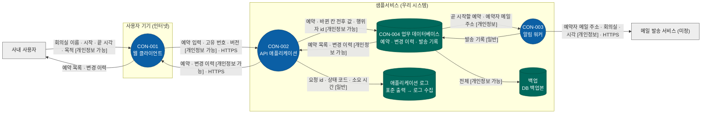

# 데이터 흐름 다이어그램(DFD) — 회의실 예약 · 목표 상태

> **골격** — 기능 하나의 DFD 견본이다(예시 도메인 「공유 회의실 예약」). 파일 이름은 `09_data_flow_<기능>.md`이고, 외부 전송 · 개인정보 · 비동기가 있는 기능마다 한 장을 만든다.

> **문서 코드**: 없음 (흐름 1건)
> **상위 문서**: [01_c4_context.md](01_c4_context.md) (외부 엔티티 이름) · [02_c4_container.md](02_c4_container.md) (프로세스 · 저장소 이름) · [srs_04_non_functional_requirements.md](../../../03.srs/srs_04_non_functional_requirements.md)
> **연관**: [05b_scenarios_phase2.md](05b_scenarios_phase2.md) · [10_sequence_reservation.md](10_sequence_reservation.md)
> **작성 규칙**: [.claude/rules/architecture-diagram/data-flow-diagram](../../../../.claude/rules/architecture-diagram/data-flow-diagram)
> **수준**: 레벨 1 (컨테이너 단위)
> **상태**: 목표 상태 (골격)
> **작성일**: <YYYY-MM-DD>

이 문서는 **예약 데이터가 어디서 생겨 어디에 머물고 누구에게 나가는지**를 고정한다. 보안 · 개인정보 검토의 기준 자료이며, 호출 순서 · 재시도 · 분기는 [10_sequence_reservation](10_sequence_reservation.md)의 몫이라 여기 그리지 않는다.

---

## 1. 데이터 흐름 다이어그램

> **범례** — 원 = 프로세스(컨테이너) · 원통 = 저장소 · 사각형 = 외부 엔티티 · `subgraph` = 신뢰 경계. 화살표 방향 = **데이터가 이동하는 방향**(요청 방향이 아니다). `[개인정보 가능]`은 「목적」 자유 입력에 사람 이름 · 연락처가 적힐 수 있다는 뜻이다 — 그런 칸은 없지만 막을 수 없다.

---

## 2. 데이터 인벤토리

| 데이터 항목 | 분류 | 발생 지점 | 저장 위치 · 보존 | 수신자 |
| --- | --- | --- | --- | --- |
| 예약(회의실 · 시각 · 목적) | 개인정보 가능 | 사내 사용자 | `CON-004` · <보존 기간> | 사내 사용자 전체 |
| 변경 이력(바뀐 칸 전후 값 · 행위자 id · 시각) | 개인정보 가능 · 계정 식별자 | `CON-002` | `CON-004` · 추가 전용 · 예약과 같은 보존 | 사내 사용자 전체 |
| 예약자 메일 주소 | 개인정보 | 사내 인증 제공자(로그인 때) | `CON-004` · 계정이 살아 있는 동안 | `CON-003` → 메일 발송 서비스 |
| 요청 로그 | 일반 — **예약 본문 없음** | `CON-002` · `CON-003` | 애플리케이션 로그 | 운영 담당(숫자만) |

**빠뜨리기 쉬운 저장소 점검**

1. **애플리케이션 로그** — 요청 id · 상태 코드 · 소요 시간만 쓴다. 예약 본문 · 목적을 로그에 남기지 않는다.
2. **백업** — DB 백업본에 예약 · 이력이 들어간다. 보존 기간이 지나 지운 예약이 백업에 얼마나 남는지 <백업 보존 기간>을 처리방침에 적는다.
3. **처리 엔진의 임시 파일** — 없다.
4. **캐시 · 큐** — 없다.
5. **브라우저** — 예약 데이터를 기기에 저장하지 않는다.

---

## 3. 신뢰 경계를 넘는 흐름

| 흐름 | 데이터 | 보호 수단 |
| --- | --- | --- |
| 사용자 기기 → `CON-002` | 예약 입력 · 고유 번호 · 버전 | `HTTPS`(TLS 종단) · 인증 확인 · 요청 경계의 권한 판정 · 입력 검증 |
| `CON-002` → 사용자 기기 | 예약 · 변경 이력 | `HTTPS` · 로그인한 사내 사용자만 |
| `CON-003` → 메일 발송 서비스 | 예약자 메일 주소 · 회의실 · 시각 | `HTTPS` · 목적(자유 입력)은 보내지 않는다 |

---

## 4. 제3자 전송 목록

| 수신 시스템 | 전송 데이터 항목 | 목적 |
| --- | --- | --- |
| 메일 발송 서비스 (미정) | 예약자 메일 주소 · 회의실 이름 · 시작 · 끝 시각 | 시작 전 알림. 「목적」 칸은 자유 입력이라 보내지 않는다 |

---

## 5. 가정 및 확인 필요 · 경고

| # | 항목 | 내용 |
| ---: | --- | --- |
| A-1 | 보존 기간 | 예약 · 이력의 보존 기간이 SRS에 없다. 정해지면 인벤토리와 백업 보존을 함께 적는다 |
| A-2 | 메일 발송 서비스의 보관 | 발송 서비스가 본문 · 주소를 얼마나 보관하는지 모른다. 수단을 고를 때 확인한다 |

---

## 6. 자체 점검

| # | 점검 항목 | 결과 |
| ---: | --- | :--: |
| 1 | 화살표가 데이터 이동 방향이고 라벨이 데이터 이름인가 | ✅ |
| 2 | 순서 · 조건 · 재시도가 그림에 섞이지 않았는가 | ✅ 시퀀스 문서로 넘겼다 |
| 3 | 저장소 ↔ 저장소, 저장소 ↔ 외부 엔티티 직접 연결이 없는가 | ⚠️ 백업 화살표(`S1` → `S3`)는 백업 프로세스를 거치지만 이 수준에서 생략했다 — 배포 다이어그램의 몫 |
| 4 | 로그 · 백업 · 임시 파일 · 캐시 · 큐 · 브라우저를 점검했는가 | ✅ §2 |
| 5 | 민감 분류 데이터가 경계를 넘는 모든 지점에 보호 수단이 있는가 | ✅ §3 |
| 6 | 이름이 컨텍스트 · 컨테이너 다이어그램과 일치하는가 | ✅ `scripts/check-diagrams.sh` 통과 |

요약 : 예약 데이터는 **기기 → API → DB** 로 흐르고, 밖으로 나가는 것은 **알림 메일에 실린 주소 · 회의실 · 시각**뿐이다.
