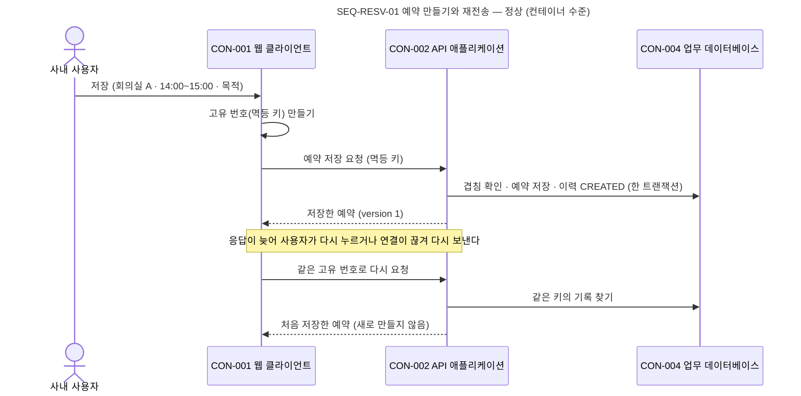
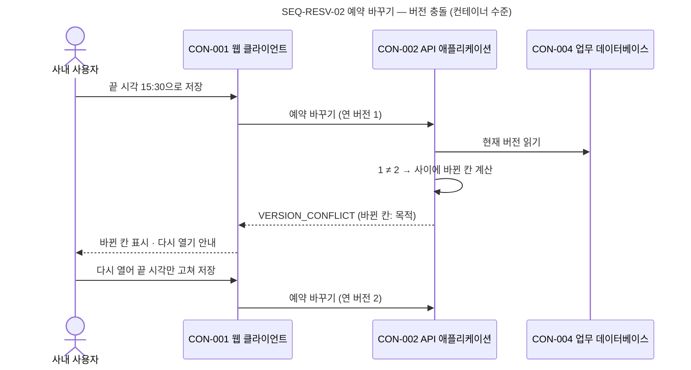

# 시퀀스 다이어그램 — 회의실 예약 · 목표 상태

> **골격** — 기능 하나의 시퀀스 견본이다(예시 도메인 「공유 회의실 예약」). 파일 이름은 `10_sequence_<기능>.md`, 시나리오 ID는 `SEQ-<기능>-NN` 하나로 쓴다.

> **문서 코드**: `SEQ-RESV-01` ~ `SEQ-RESV-02`
> **상위 문서**: [02_c4_container.md](02_c4_container.md) (참여자 이름 · 관계 정본) · [05b_scenarios_phase2.md](05b_scenarios_phase2.md) (`UC-002` `UC-003`)
> **연관**: [09_data_flow_reservation.md](09_data_flow_reservation.md)
> **작성 규칙**: [.claude/rules/architecture-diagram/sequence](../../../../.claude/rules/architecture-diagram/sequence)
> **수준**: 컨테이너 수준
> **상태**: 목표 상태 (골격)
> **작성일**: <YYYY-MM-DD>

시퀀스 다이어그램은 **정적 다이어그램이 말하지 못하는 순서 · 비동기 구간 · 실패 뒤 상태**를 고정한다. 시나리오마다 한 장이다.

| ID | 시나리오 | UC | 참여자 | 메시지 |
| --- | --- | --- | --- | --- |
| `SEQ-RESV-01` | 예약 만들기와 재전송 — 정상 | `UC-002` | 4 | 8 |
| `SEQ-RESV-02` | 예약 바꾸기 — 버전 충돌 | `UC-003` | 4 | 8 |

**표기** — `->>` 동기 요청 · `-->>` 응답 · `-)` 비동기 시작. 응답은 이후 흐름에 의미가 있을 때만 그렸다.

---

## `SEQ-RESV-01` · 예약 만들기와 재전송 — 정상

| 항목 | 내용 |
| --- | --- |
| **사전 조건** | 사내 사용자가 로그인했다. 같은 회의실 · 같은 시간에 진행 중 예약이 없다 |
| **트리거** | 사내 사용자가 「회의실 A」 14:00~15:00 예약을 저장한다 |
| **사후 조건** | 예약 하나가 `ACTIVE`로 저장되고 이력 `CREATED` 한 줄이 남는다. 재전송해도 하나다 |

**노트**

1. **트랜잭션 경계** — 겹침 확인 · 예약 저장 · 이력 추가가 한 트랜잭션이다. 이력만 남거나 예약만 남는 일이 없다.
2. **시간 제한 · 재시도** — 화면은 응답이 없으면 같은 고유 번호로 다시 보낸다. 번호를 새로 만들지 않는다.
3. **같은 입력(멱등)** — 고유 번호는 유일 제약으로 지킨다. 같은 번호의 재전송은 처음 기록을 돌려준다.
4. **사람 대기** — 없다.
5. **그림을 줄인 곳** — 요청 경계의 판정(인증 · 권한)은 `CON-002` 안이라 따로 그리지 않았다.

---

## `SEQ-RESV-02` · 예약 바꾸기 — 버전 충돌

| 항목 | 내용 |
| --- | --- |
| **사전 조건** | 사내 사용자가 version 1을 열어 두었다. 그사이 관리자가 목적을 고쳐 version 2가 됐다 |
| **트리거** | 사내 사용자가 끝 시각을 15:30으로 바꿔 저장한다 |
| **사후 조건** | 예약은 version 2 그대로다. 화면에 사이에 바뀐 칸이 보이고, 다시 열어 고칠 수 있다 |

**노트**

1. **트랜잭션 경계** — 버전 비교와 변경 · 이력 추가가 한 트랜잭션이다. 버전이 다르면 아무것도 쓰지 않는다.
2. **시간 제한 · 재시도** — 충돌은 재시도하지 않는다. 사람이 다시 열어 판단한다.
3. **같은 입력(멱등)** — 버전 없이 보내면 거부한다. 같은 버전으로 두 번 보내면 두 번째는 충돌이 된다.
4. **사람 대기** — 충돌 뒤 다시 열 때까지 예약은 version 2로 남는다.
5. **그림을 줄인 곳** — 두 번째 저장 이후는 `SEQ-RESV-01`의 저장과 같은 순서라 그리지 않았다.

---

## 분리한 대안 · 실패 시나리오 (그리지 않음)

| 시나리오 | 그리지 않은 이유 | 동작이 적힌 곳 |
| --- | --- | --- |
| 같은 회의실 겹침 | 겹침 확인에서 거부 — 메시지 3개 | [05b](05b_scenarios_phase2.md) `UC-002` 실패 케이스 |
| 고유 번호 없이 저장 | 경계 검증에서 거부 | [05b](05b_scenarios_phase2.md) `UC-002` 실패 케이스 |
| 남의 예약을 바꾸려 함 | 요청 경계에서 없는 예약과 같은 응답 | [04](04_use_case_diagram.md) §4 공통 사전조건 |
| 이미 취소된 예약 다시 취소 | 같은 결과를 돌려준다 — 메시지 2개 | [05b](05b_scenarios_phase2.md) `UC-004` 실패 케이스 |

## 가정 · 확인 필요 · 경고

| # | 항목 | 내용 |
| ---: | --- | --- |
| A-1 | 인터페이스 | 메시지 이름은 뜻만 적었다. 경로 · 헤더 · 상태 코드는 스택을 고른 뒤 계약 문서(`specs/<NNN>-<기능>/contracts`)가 정한다 |

## 자체 점검

| # | 점검 항목 | 결과 |
| ---: | --- | :--: |
| 1 | 다이어그램마다 시나리오 하나 · 제목에 시나리오명과 수준이 있는가 | ✅ |
| 2 | 참여자 이름이 C4와 같고 수준이 섞이지 않았는가 | ✅ 컨테이너 수준 |
| 3 | 참여자 7개 · 메시지 20개 이하인가 | ✅ 표 참조 |
| 4 | 모든 메시지가 정적 다이어그램 관계와 대응하는가 | ✅ [02](02_c4_container.md) §3 관계 2 · 3 |
| 5 | 트랜잭션 경계 · 멱등 키 · 사람 대기 구간을 노트로 적었는가 | ✅ |

요약 : 예약 저장은 **고유 번호로 한 번만 저장되고**, 바꾸기는 **버전이 맞을 때만** 쓴다. 충돌은 재시도하지 않고 사람에게 바뀐 칸을 보여 준다.
